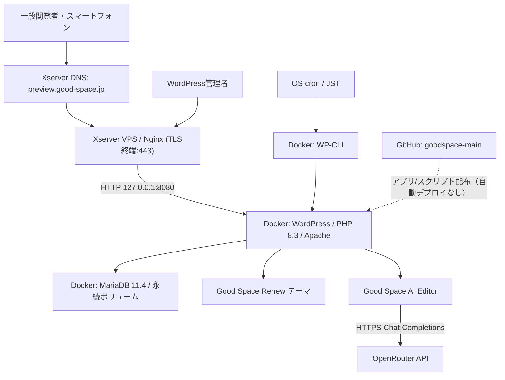
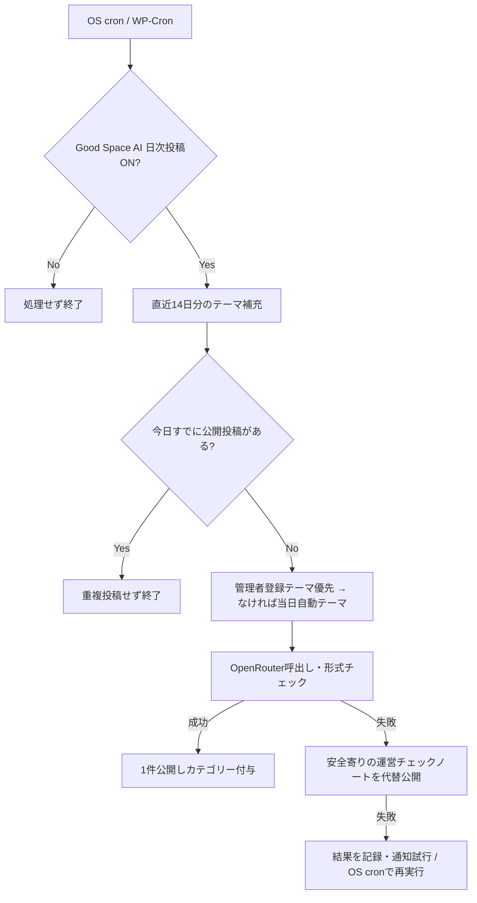

# Good Space 新Webサイト システム設計書

| 項目 | 内容 |
| --- | --- |
| 文書ID | GS-WEB-DS-001 |
| 版数 | 1.0 |
| 作成日 | 2026-10-15 |
| 対象 | Good Space WordPressリニューアル・ブログ・AI記事自動公開 |
| 対象リポジトリ | [softrenzu/goodspace-main](https://github.com/softrenzu/goodspace-main) |
| 設計の根拠 | 本リポジトリのテーマ、プラグイン、Compose、運用スクリプトおよび2026-10-13に利用者が提示したVPS実行結果 |
| 情報区分 | 技術資料・機密情報（パスワード/APIキーの実値）は非掲載 |

> **状態の区別:** WordPressのトップ表示、管理画面、手動ブログ投稿・編集、OpenRouter経由の下書き生成・公開、HTTPS表示は2026-10-13の画面・操作ログで確認された。2026-10-15にGitHubへ追加された**カテゴリー別ブログの改修はGitHub上の実装であり、VPSへの反映・本番確認までは完了とみなさない**。毎日自動公開はCron登録と手動CLI確認まで実績があるが、連続日次稼働の達成保証ではない。

## 1. 目的・対象範囲

### 1.1 目的

1. Good Spaceの民泊運営代行、レンタルスペース運営、空室活用のサービス内容を分かりやすく提示し、相談に誘導する。
2. カテゴリー・検索機能を持つ情報発信サイトを構築し、スマートフォンから目的の記事へ最短で到達できるようにする。
3. WordPressの管理画面から、人が手動投稿・編集できるようにする。
4. OpenRouter経由のAIによる記事生成と自動公開を行い、テーマを自動補充して日次投稿の継続を目指す。
5. 既存の `https://good-space.jp/` を**承認前に切り替えない**。開発中は `https://preview.good-space.jp/` を独立して利用する。

### 1.2 対象外・非保証

- 既存の本番サイト・既存投稿・既存問い合わせ履歴の自動移行。
- 新サイトの有効性・売上増加・稼働率改善等の数値保証。
- AIによる最新法令・自治体条例・外部Webページの自動調査または事実の真偽検証。
- サーバー停止、回線障害、API障害、支払失効があっても**必ず日次投稿を保証すること**。アプリはベストエフォートで再実行と代替投稿を行う。
- バックアップファイルの遠隔保管・復元自動化（現行コードはローカルバックアップのみ）。

## 2. 全体構成

NginxはVPSホストの80/443番を受け、Good SpaceのWordPressは**127.0.0.1:8080のみ待受**。MariaDBは外部公開しない。同一VPSで稼働中のマンスリー予約・宿泊者名簿等の他サービスを再起動・変更せず共存させる。

| 層 | コンポーネント | 役割 |
| --- | --- | --- |
| 名前解決 | Xserver DNS（`ns1～ns5.xserver.jp`） | プレビュー用Aレコード管理 |
| エッジ | Nginx + Let's Encrypt / Certbot | TLS終端、HTTP→HTTPS、WordPressへのリバースプロキシ |
| Web | `wordpress:php8.3-apache` | 公開サイト・管理画面・ブログ |
| データ | `mariadb:11.4` | 記事、ユーザー、設定、AIテーマ等 |
| 管理 | `wordpress:cli-php8.3` | DB/記事設定、スケジュール処理、点検 |
| デザイン | `frontend/themes/goodspace/` | テンプレート、CSS、メニュー、カテゴリー |
| AI | `frontend/plugins/goodspace-ai-editor/` | API呼出し、記事生成、日次公開、失敗時の代替記事 |
| 定期実行 | ホストOSの `cron` | テーマ補充、公開確認と再試行 |
| 構成管理 | GitHub / `main` | PHP、CSS、設定テンプレート、運用スクリプト |

## 3. 画面・情報設計

### 3.1 主要ページ

| 画面 | 主なURL | WordPress/テーマ実装 |
| --- | --- | --- |
| トップ | `/` | `front-page.php` |
| 事業内容 | `/service/` | `page-service.php` |
| 民泊運営代行 | `/service/minpaku/` | `page-minpaku.php` |
| レンタルスペース | `/service/rental-space/` | `page-rental-space.php` |
| 会社概要 | `/company/` | `page-company.php` |
| お問い合わせ | `/contact/` | `page-contact.php`（現状はメール・電話への導線、フォーム送信機能は別途設計） |
| ブログ一覧 | `/blog/` | `home.php` |
| カテゴリー別一覧 | WordPressカテゴリーURL（例 `/category/operations/`） | `category.php` |
| 記事検索 | `/?s=キーワード&post_type=post` | `search.php` |
| 記事詳細 | `/blog/%postname%/` | `single.php` |
| WordPress管理画面 | `/wp-admin/` | WordPressコア |
| AI編集画面 | `/wp-admin/admin.php?page=gsai-editor` | 独自プラグイン |

**導線設計:** トップ→事業説明→相談。ブログ→カテゴリー/検索→記事→該当サービス・相談。モバイルではハンバーガーメニューからカテゴリーとキーワード検索に到達可能とする。トップの表現・施設写真・訴求内容は承認前の調整対象である。

### 3.2 カテゴリー定義（WordPress標準 `category`）

| 固定スラッグ | 表示名 | 内容 |
| --- | --- | --- |
| `minpaku-start` | 民泊の始め方 | 開業準備 |
| `operations` | 運営ノウハウ | 予約、清掃、運営改善 |
| `rental-space` | レンタルスペース | 時間貸し・運営 |
| `real-estate` | 不動産・空室活用 | 空室、物件選定 |
| `booking-marketing` | 集客・予約サイト | Airbnb、OTA、掲載 |
| `laws` | 法令・許認可 | 民泊新法、旅館業法、条例など |
| `inbound` | インバウンド | 多言語・訪日客対応 |
| `news` | Good Spaceのお知らせ | 会社・サービス情報 |

カテゴリー一覧と説明は `frontend/themes/goodspace/inc/blog-categories.php` で管理。テーマ有効時に未作成のカテゴリーを登録する。テーマからの自動カテゴリー判定は**キーワードベースの単一カテゴリ推定**であり精度の保証はない。人が明示したカテゴリ指定を優先する。既存記事は未分類のみ対象とする整理スクリプトを用意している。

## 4. データ・状態設計

| 対象 | WordPress保存先 | 主要情報 |
| --- | --- | --- |
| 一般記事 | `wp_posts`、`post_type=post` | タイトル、本文、公開状態、日時、カテゴリー |
| AI記事テーマ | カスタム投稿タイプ `gs_ai_topic` | テーマ名、確認済み事実、参照URL |
| AIテーマ補助データ | `wp_postmeta` | `gsai_verified_facts`, `gsai_source_urls`, `gsai_auto_day`, `gsai_category_slug` |
| 生成済み関連付け | `wp_postmeta` | `gsai_generated_post`, `gsai_source_topic` |
| 公開後の注意フラグ | `wp_postmeta` | `gsai_needs_fact_check`, `gsai_daily_needs_review` |
| OpenRouter設定 | `wp_options` | `gsai_openrouter_key`, `gsai_openrouter_model` |
| スケジュール設定 | `wp_options` | `gsai_daily_enabled`, WordPress Cronイベント |
| 日次実行結果 | `wp_options` | `gsai_daily_last_result`, `gsai_last_topic_refill` |
| カテゴリー | `wp_terms` 等 | 表示名、スラッグ、記事との関連付け |
| 添付画像 | `wp_data` 内のuploads | メディアライブラリ |
| DB | `db_data` 永続ボリューム | MariaDBデータ |

テーブル接頭辞はWordPress実機設定に依存するため、ここでの `wp_*` は論理名。APIキーの実値・DBパスワード等はGit管理しない。

## 5. AI記事生成と自動公開の処理設計

### 5.1 人手での記事作成

1. WordPress管理者が投稿を新規作成・更新する。
2. カテゴリーを指定し、必要に応じてアイキャッチ・本文・抜粋を設定する。
3. `公開` によってWebに即時反映する。既存の投稿も更新可能。

### 5.2 AI記事生成

1. 管理者がOpenRouterキー・モデルを登録する。
2. テーマと30文字以上の確認済み事実、HTTPS参考URLを登録するか、自動テーマ補充を利用する。
3. プラグインはOpenRouterの `/api/v1/chat/completions` にJSON（`title`、`excerpt`、`content_html`）を要求する。
4. HTMLを `wp_kses_post` 等で整形し、**タイトル8～115文字、本文400文字以上、h2見出しの存在**を最低限の形式条件として検査する。
5. 検査合格時は `post_status=publish` で公開し、カテゴリーを付与する。テーマとの関連付けを保存する。
6. 不合格/通信エラー時は日次バッチに限り一般的な運営チェックノートへの代替を試みる。

**重要:** ここでの「品質チェック」は形式条件であり、事実確認・法令確認・盗用チェックではない。参考URLは記録・リンク化されるが、プラグインはURL本文を自動閲覧しない。個人情報・未公開機密をテーマへ入力しない。

### 5.3 毎日1記事のバッチ設計

- 日本時間 `07:00` 以降に処理する。WordPress側のイベント名は過去互換のため `gsai_generate_one_draft` のまま。
- 毎日 `00:15` に14日分のテーマ候補を補充する。期限切れ未使用の**自動**テーマのみ下書きへ退避し、人が登録したテーマを維持する。
- 投稿処理はMariaDBの `GET_LOCK` で多重実行を抑え、今日すでに公開記事があれば追加しない（自動記事以外の手動公開も1件として数える）。
- API停止時には固定の一般業務チェック記事を公開できる。ただし内容の反復・一般性の高さは編集上の問題である。
- 当日の実行期限を超えて翌日になった場合、**前日分を自動遡及公開する設計ではない**。

## 6. 非機能要件・品質基準

| 分野 | 設計方針・現状 |
| --- | --- |
| レスポンシブ | PC/スマホのCSS対応、モバイルカテゴリメニュー |
| アクセシビリティ | 主要操作のラベル・フォーカス表示、一覧・検索の適切なマークアップを目指す。第三者評価は未実施 |
| セキュリティ | TLS、管理者権限チェック/nonce、入力サニタイズ、WordPress管理者認証、ローカルポート制限 |
| データ保全 | DBおよびuploadsのローカルバックアップ。遠隔保存と復元テストは未実装 |
| 更新 | GitHub上のPHP/CSSをVPSへ手動同期。CI/CD自動反映なし |
| 運用監視 | CLIによる状態確認とcronの実行ログ。外形監視・異常通知の確実な到達は未保証 |
| 投稿一意性 | 当日公開記事を確認し原則重複投稿を回避。障害・並行更新では実地検証が必要 |
| SEO | 公開前のプレビュー環境はnoindexを推奨。本番切替後にメタ・サイトマップ等を再検証 |
| 情報精度 | 架空の数値・法制度・実績を作らないようプロンプトで制限。ただしAIの誤記は起こり得る |

## 7. 変更管理と受入テスト

### 7.1 GitHub / VPS反映

- コードの正本は `main`。プラグイン・テーマ・スクリプトをGitHubで管理する。
- 実運用の `.env`、DBボリューム、アップロード画像、Nginx TLS設定、証明書はGitHub管理の対象外。
- **VPSでの手動修正がGitHubに存在しない場合がある。** 一括 `git reset --hard` や `docker compose down -v` を禁止し、対象ファイルだけ差分確認・バックアップ・反映する。

### 7.2 テスト観点

| ID | 確認内容 | 期待結果 |
| --- | --- | --- |
| T-01 | `https://preview.good-space.jp/` | TLSとトップ表示 |
| T-02 | 管理画面ログイン | 権限のある利用者だけログイン |
| T-03 | 手動記事の投稿→編集 | 公開・更新がWebに反映 |
| T-04 | `/blog/` | カテゴリーカード・検索欄・記事カードを表示 |
| T-05 | カテゴリーページ | 選んだカテゴリーの投稿だけ一覧 |
| T-06 | モバイルメニュー | 8カテゴリーへ移動できる |
| T-07 | 既存投稿の再分類 | 未分類のみ変更、既存手動分類は保持 |
| T-08 | AI記事生成 | JSON/HTMLを検査後に公開、カテゴリー付与 |
| T-09 | 14日テーマ補充 | 未作成の日付のテーマ候補が増える |
| T-10 | 同日再実行 | `already_published`、重複増なし |
| T-11 | API障害 | 代替記事または失敗記録。無言で放置しない |
| T-12 | OS cron | `00:15` 補充と `07:05` 以降の公開確認ログ |
| T-13 | 障害復旧 | 既存MariaDBデータを消さず復元できる |
| T-14 | 既存サービス | 月次予約等ほかのコンテナ・Nginx設定を維持 |

## 8. 既知の課題・次期改善

1. **初期化スクリプト差分:** GitHubの `scripts/initialize_site.sh` にはWP-CLIへの `wp` 引数不足が残る可能性があり、VPSでは2026-10-13に手動修正した経緯がある。再構築前に修正・検証が必要。
2. **HTTPS検知差分:** GitHubの `docker-compose.yml` には、VPSで追加したリバースプロキシの `X-Forwarded-Proto` 検知用のPHP設定が含まれていない。新規インストール時はTLS配下の転送ループ/500を防ぐ必要がある。
3. **AIの公開品質:** 現行は書式検査のみ。法令・地域ルール等の一次資料照合、重複検出、公開後レビュー/差し戻しのワークフロー改善が必要。
4. **投稿継続:** OS停止やAPI失敗以外の障害に対する独立監視・通知（メール送信経路を含む）および別系統のフェイルオーバーは未整備。
5. **訴求力:** トップページのベネフィット・実績・CTAと実物写真は承認前に再設計する。
6. **本番移行:** 既存サイトのバックアップ、URL対応表、301リダイレクト、計測・SEO、メール/法定ページ確認を経て、正式承認後にのみ実施する。

---

関連資料: [環境設定書](環境設定書.md) / [導入手順](../README_導入手順.md) / [公開前チェックリスト](公開前チェックリスト.md)。
